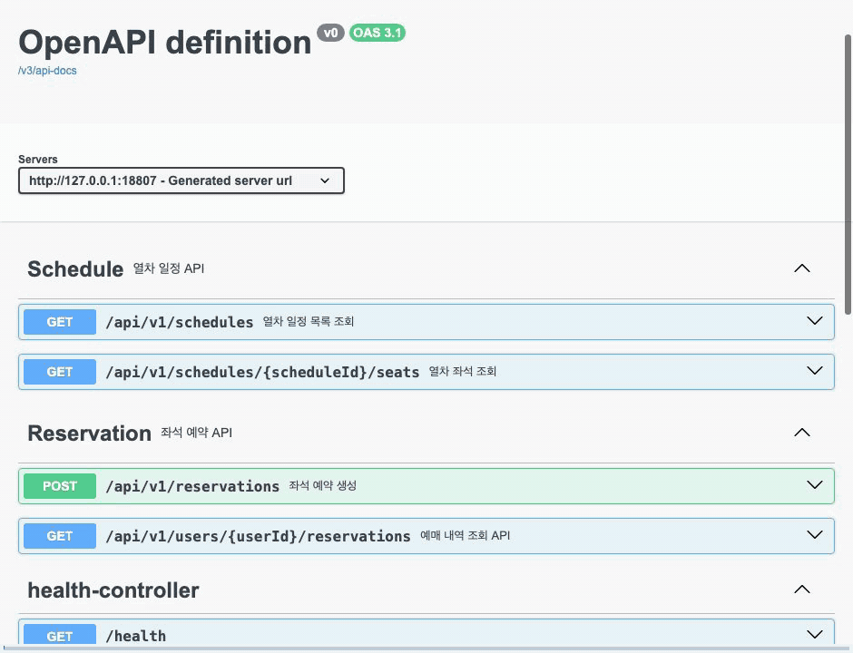
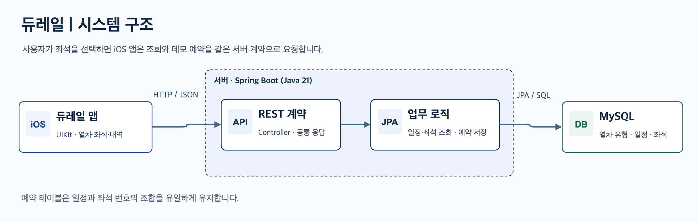
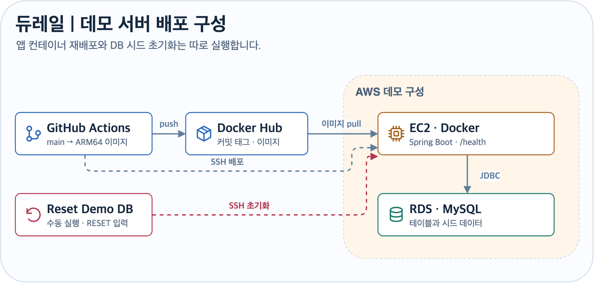
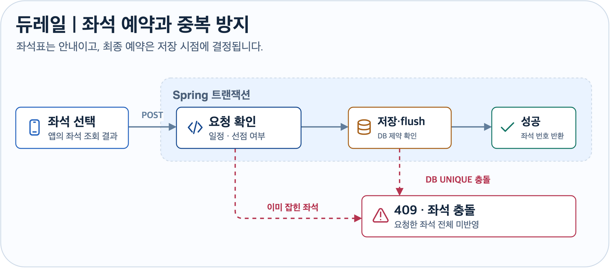

# 듀레일 | 코레일톡 예매 흐름을 위한 서버

열차를 고를 때 **콘센트 좌석을 예약할 수 있는지** 먼저 확인하고, 고른 좌석을 저장해 예매 내역에서 다시 확인하는 iOS 데모입니다. LET’S SOPT 38기 합동세미나에서 디자인·iOS·서버가 같은 화면과 API 명세를 기준으로 협업했습니다.

**2026년 5월 · 팀 프로젝트 · 백엔드**

Java 21 · Spring Boot 4 · Spring Data JPA · MySQL · GitHub Actions · Docker

[서버 저장소](https://github.com/SOPT-all/38-COLLABORATION-SERVER-KORAILTALK) · [팀 iOS 저장소](https://github.com/SOPT-all/38-COLLABORATION-iOS-KORAILTALK)

## 문제 정의와 담당 범위

좌석 배치 화면까지 들어간 뒤에야 원하는 콘센트 좌석이 하나도 남지 않았다는 걸 알아차리면 열차 목록으로 돌아가 다시 골라야 합니다. 듀레일은 열차 목록에서 **전체 매진**과 **콘센트 좌석 매진**을 따로 알려 주고, 좌석 조회와 예약을 이어줍니다.

| 구분 | 맡은 일 |
| --- | --- |
| 담당 | 열차 일정 조회와 좌석 예약 생성 API 구현, 좌석 조회 API 병합 충돌 정리 |
| 담당 | 공통 응답·전역 예외 처리와 JPA 생성·수정 시간 공통화, 데모 배포 파이프라인 단순화와 DB 초기화 절차 정리 |
| 팀 | 기능·화면 기획, UIKit 앱과 네트워크 연결, 서버 도메인·좌석 조회·예매 내역 API의 공동 개발 |

## 대표 시연

### 콘센트 좌석을 찾아 예매하기

<table>
<tr><th>승차권 조회</th><th>콘센트 좌석 선택</th></tr>
<tr><td></td><td></td></tr>
<tr><th>승차권 확인</th><th>나의 티켓</th></tr>
<tr><td></td><td></td></tr>
</table>

콘센트가 필요한 승객은 먼저 열차 목록에서 좌석이 남아 있는 열차를 고릅니다. 좌석표에서 콘센트 표시와 이미 예약된 자리를 구분한 뒤, 선택한 좌석 정보를 승차권 화면에서 다시 봅니다. [팀 iOS 시연 모음](https://github.com/SOPT-all/38-COLLABORATION-iOS-KORAILTALK#readme)

### 좌석 예약부터 예매 내역까지 · Swagger



Swagger에서 열차 일정과 좌석표를 차례로 조회합니다. 콘센트가 있는 3번 좌석을 예약한 뒤, 같은 사용자로 예매 내역을 열면 3번 좌석과 총액 59,800원이 나옵니다.

## 주요 기능과 사용자 흐름

열차 목록의 **콘센트 좌석 매진** 표시는 어떤 열차의 좌석표를 열지 고르는 데 쓰입니다. 비어 보이던 좌석도 예약 직전에 다른 사람이 먼저 잡을 수 있습니다. 그때 서버는 예약을 거절하고, 좌석표를 다시 확인할 수 있게 이미 예약된 좌석임을 알려줍니다.

## 아키텍처

### 시스템 구조



[편집 원본](assets/readme/korail-system.drawio)

### 데모 서버 배포 구성



[편집 원본](assets/readme/korail-infra.drawio)

### 좌석 예약 흐름



[편집 원본](assets/readme/korail-reservation.drawio)

## 기술적 의사결정과 문제 해결

### 1. 좌석 조회 결과는 안내로 쓰고 중복 예약은 DB에서 막았습니다

좌석이 비어 있다는 조회 결과를 받은 두 사람이 거의 동시에 같은 좌석을 고를 수 있습니다. 요청이 들어왔을 때 기존 예약을 먼저 확인하면 이미 자리 잡힌 좌석은 빠르게 거절할 수 있지만, 두 요청이 동시에 그 검사를 통과하는 경우까지 막지는 못합니다.

예약 저장은 한 트랜잭션에서 처리하고 `(schedule_id, seat_number)` 유일 제약으로 최종 충돌을 막았습니다. `saveAll` 뒤에 `flush`를 호출해 저장 중 충돌을 `409`로 돌려주고, 여러 좌석 중 한 자리라도 충돌하면 일부 성공으로 응답하지 않습니다. DB까지 기록해야 최종 성공을 판정하므로 화면의 좌석 상태를 서버가 보장하는 상태와 혼동하지 않습니다. [예약 API PR #24](https://github.com/SOPT-all/38-COLLABORATION-SERVER-KORAILTALK/pull/24)

### 2. 목록의 매진 여부는 실제 예약 좌석으로 계산했습니다

앱이 열차마다 좌석 화면에 들어가 확인해야 하면 비교 동작이 늘어납니다. 반대로 별도 매진 플래그를 저장하면 예약 상태가 바뀔 때 플래그도 갱신해야 합니다. 열차 일정 응답에서 예약 좌석 집합과 열차 유형의 콘센트 좌석 목록을 비교해 `isSoldOut`과 `isOutletSoldOut`을 각각 계산하도록 했습니다.

매진 플래그를 별도 데이터로 맞출 필요는 없지만, 현재 구현은 일정별로 예약 좌석을 조회합니다. 목록이 커지면 일정별 조회 비용이 늘어나는 구조입니다. 빈 일정은 리소스 오류가 아니라 정상적인 목록 결과로 보고 빈 배열을 반환합니다. [일정 조회 PR #18](https://github.com/SOPT-all/38-COLLABORATION-SERVER-KORAILTALK/pull/18)

### 3. 데모 앱 재배포와 데모 데이터 초기화를 분리했습니다

앱을 다시 띄울 때마다 시드까지 적용하면 데모 진행 중 상태와 서버 재배포가 묶입니다. 데모 배포는 main 커밋의 ARM64 이미지를 만들어 EC2가 동일 태그를 가져가도록 하고, 앱 시작 시 Hibernate는 스키마를 검증합니다. 재현용 데이터가 필요할 때는 별도의 수동 초기화에서만 스키마와 시드를 다시 적용합니다.

그 결과 DB 초기화가 의도적인 운영 동작으로 남습니다. 대신 새 스키마가 필요한 변경은 배포 전에 데이터 초기화 또는 스키마 반영 시점을 맞춰야 합니다. 네트워크 경로가 있는 EC2에서 원격 DB 초기화를 실행하도록 했고, 시드 문자셋을 명시해 한글이 깨지는 문제를 정리했습니다. [ARM64 빌드 PR #12](https://github.com/SOPT-all/38-COLLABORATION-SERVER-KORAILTALK/pull/12) · [스키마 초기화 PR #15](https://github.com/SOPT-all/38-COLLABORATION-SERVER-KORAILTALK/pull/15) · [시드 문자셋 PR #20](https://github.com/SOPT-all/38-COLLABORATION-SERVER-KORAILTALK/pull/20)

## 실행 및 검증

Java 21과 Docker가 있는 개발 환경에서 MySQL을 시작합니다. 초기화 스크립트는 **로컬 데모 DB**의 기존 테이블을 지우고 시드를 넣습니다.

```bash
docker compose up -d mysql
bash scripts/reset-local-db-to-seed.sh
./gradlew bootRun
```

로컬 Swagger UI는 `http://localhost:8080/swagger-ui.html`입니다. 사용한 기준 판본, 화면별 증거, 데이터 격리 및 실행 결과는 [검증 기록](docs/verification.md)에 정리했습니다.
